# AjudaP.ai: Acompanhamento e Suporte

**Família, escola e profissionais de saúde acompanhando juntos o desenvolvimento de uma criança, com apoio de IA.**

Projeto do HackathonLEPV. Plataforma para crianças de 0 a 10 anos.

> **Demonstração no ar:** https://77-112-105-69.sslip.io (endereço válido durante o hackathon)
> Na tela inicial, clique em **"Família da Lia (responsável)"** ou **"Professora Carla (acompanhante)"** para entrar sem cadastro.
> Contas de demonstração: `ana@demo.primeirospassos` e `carla@demo.primeirospassos`, senha `demo1234`.

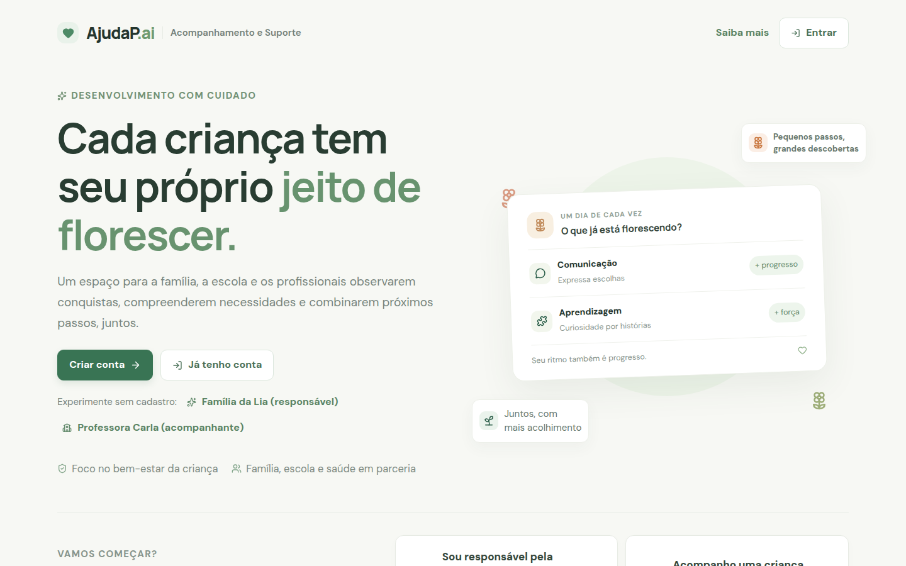

## Entregas do hackathon

| Entrega | Onde está |
| --- | --- |
| Vídeo de demonstração (até 5 min) | _link do vídeo_ |
| Plano de negócio (PDF) | [plano_de_negocio/plano.pdf](plano_de_negocio/plano.pdf) |
| Aplicação no ar, sem senha | https://77-112-105-69.sslip.io (entre pelos botões "Família da Lia" ou "Professora Carla") |
| Repositório e como rodar | este README, seção [Rodar localmente](#rodar-localmente) |
| Sessões de IA da equipe | [prompts/](prompts/), com uma pasta por integrante ([igor](prompts/igor/), [matheus](prompts/matheus/), [otavio](prompts/otavio/)) |

## O problema

Quem cuida de uma criança junta, ao longo do tempo, observações espalhadas: o que a creche contou, o que a pediatra pediu para observar, a crise de ontem, a palavra nova da semana. Cada um vê um pedaço. A família raramente tem um retrato organizado do desenvolvimento, nem sabe o que tentar em casa ou quando procurar um profissional. A escola e a saúde não conversam entre si.

## A solução

O AjudaP.ai junta essas pessoas num só lugar em volta de cada criança:

1. **A família responde um formulário amplo**, com 14 áreas do desenvolvimento e perguntas para a idade da criança.
2. **Um agente de IA monta uma proposta de perfil.** Ele consulta uma base de materiais oficiais (Caderneta da Criança do Ministério da Saúde, CDC, OMS, Harvard, EEF e outros) e propõe:
   - um semáforo por área;
   - metas de curto, médio e longo prazo;
   - dicas práticas que usam os interesses da criança.
3. **A família revisa, pede ajustes e aprova.** Nada vira plano sem a aprovação dela.
4. **No dia a dia, todos registram o que observam.** Família, professora, médico e terapeuta usam o mesmo painel. Um assistente de IA, que conhece o perfil e os registros, tira dúvidas na hora.
5. **De tempos em tempos, o agente reavalia.** Com base em tudo o que foi registrado, ele propõe uma nova versão e mostra a evolução entre as versões.

> **O AjudaP.ai não faz diagnóstico.** Ele organiza observações e sugere caminhos. Quando algo pede atenção, a orientação é sempre conversar com um profissional.

## Para quem

| Papel | Quem é | O que faz |
| --- | --- | --- |
| **Responsável pelo perfil** | Mãe, pai, avó, tutor legal | Cadastra a criança, preenche o formulário e aprova o perfil. Registra o progresso das metas, pede reavaliação e decide quem tem acesso. |
| **Acompanhante** | Professor, pedagogo, médico, terapeuta, familiar | Recebe o convite e lê o perfil, as metas e as dicas. Registra o que observa e conta quais estratégias funcionaram. Usa o canal da equipe e o assistente. |

A mesma conta pode ter os dois papéis, por exemplo a avó que é responsável por um neto e acompanhante de outro. A troca de papel fica no menu do perfil.

---

## Como funciona: o fluxo de uso

### 1. Criar a conta e cadastrar a criança

O responsável cria a conta com e-mail e senha e cadastra a criança com nome, data de nascimento e interesses. Na visão geral, ele vê todas as crianças, em que etapa cada uma está e os atalhos para painel, assistente, canal, PDF e compartilhamento.

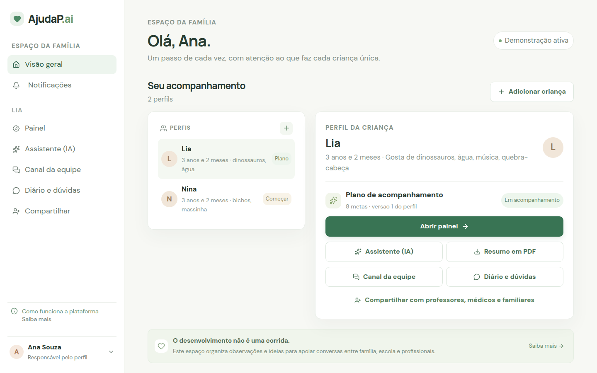

### 2. Preencher o formulário inicial

O formulário tem 16 etapas: dados iniciais, as 14 áreas do desenvolvimento e uma revisão. Cada área tem perguntas para a idade da criança, uma referência visível e campos abertos para exemplos do dia a dia, pontos fortes, desafios e apoios.

"Não sei" e "não se aplica" são respostas distintas de "ainda não". Dá para salvar, voltar e editar a qualquer momento.

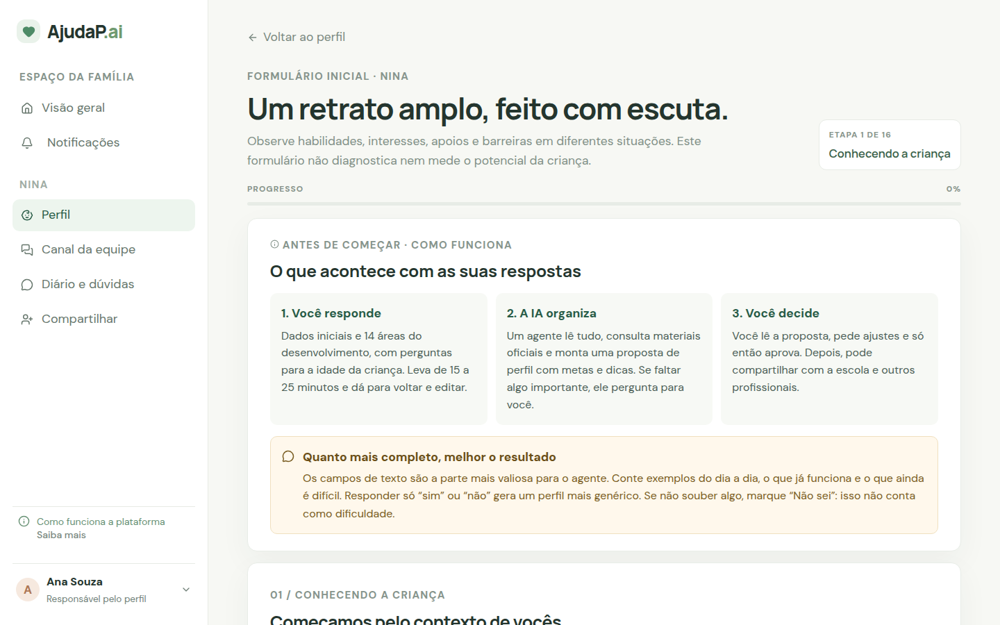

### 3. O agente propõe um perfil, e a família aprova

Ao concluir o formulário, o agente de IA trabalha ao vivo, em 1 a 2 minutos:
- lê as respostas;
- consulta a base de conhecimento;
- se faltar algo importante, faz perguntas extras ao responsável.

A proposta traz um resumo da criança, o que já vai bem e os pontos de atenção com sugestões. Também traz o **semáforo das 14 áreas**:
- 🟢 dentro do esperado;
- 🟡 pede atenção;
- 🔴 conversar com um profissional.

Cada afirmação indica de onde veio: do formulário, do relato da família ou de uma fonte da base.

O responsável pode pedir ajustes ("quero focar primeiro no sono") quantas vezes quiser e, quando estiver de acordo, aprova.

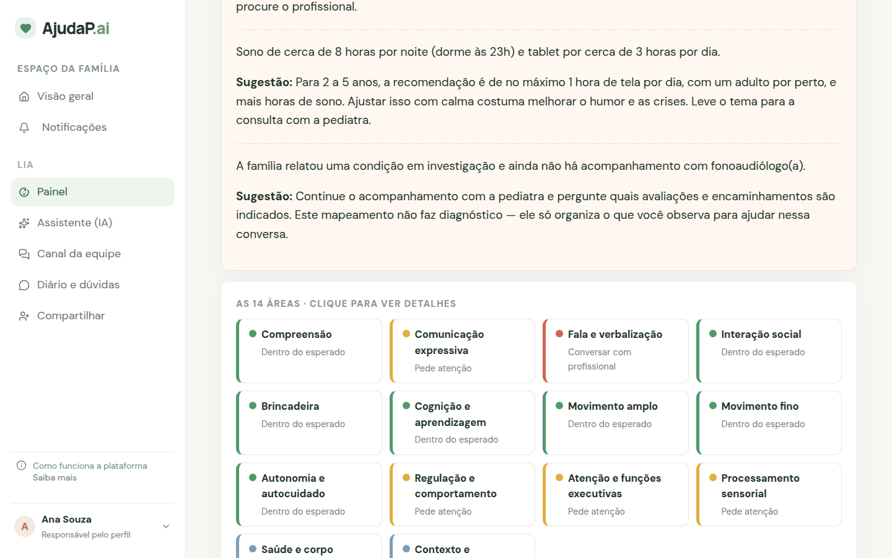

### 4. O painel da criança

Com o perfil aprovado, a família ganha o painel. Ele tem o resumo do perfil, as metas ativas, os registros da semana e as estratégias que funcionaram.

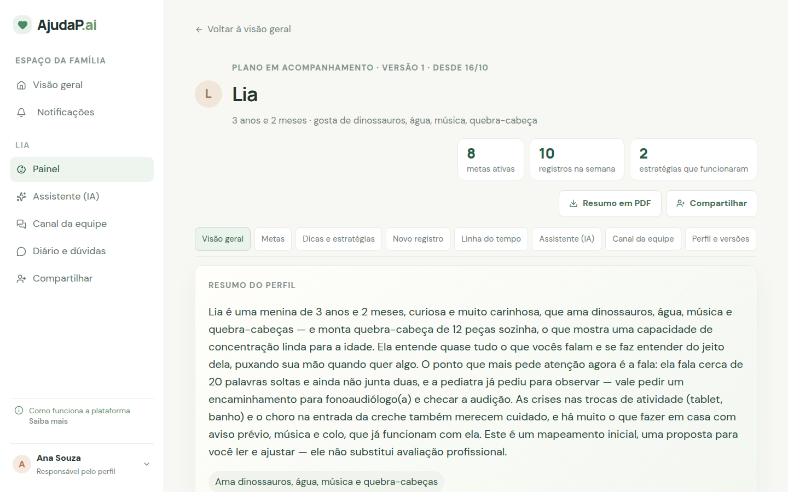

**Metas** de curto, médio e longo prazo. Cada meta é concreta e mensurável e diz como acompanhar, quem participa e de onde veio a proposta. A escala de progresso vai de −2 a +2.

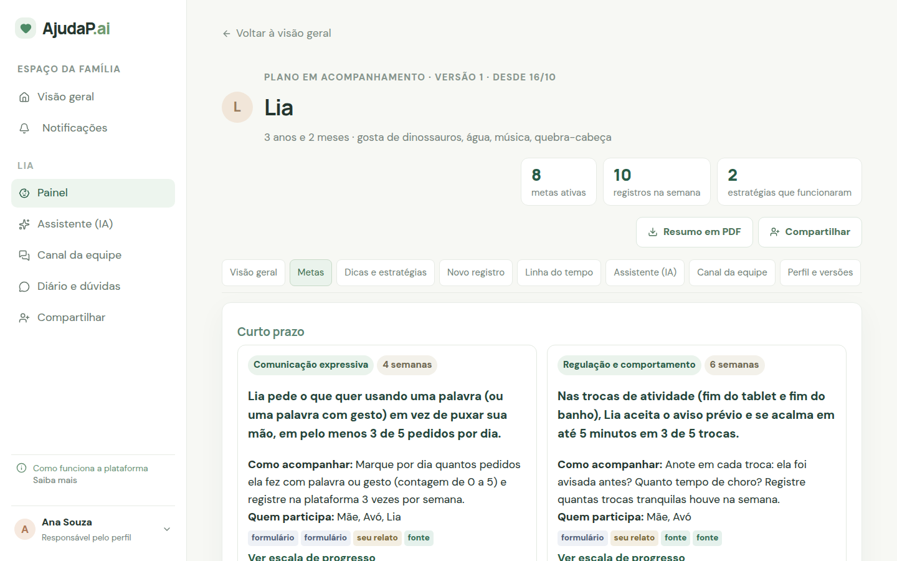

**Dicas e estratégias** práticas, passo a passo, usando os interesses da criança (aqui, os dinossauros da Lia). Cada pessoa da equipe pode marcar se a dica funcionou ou não.

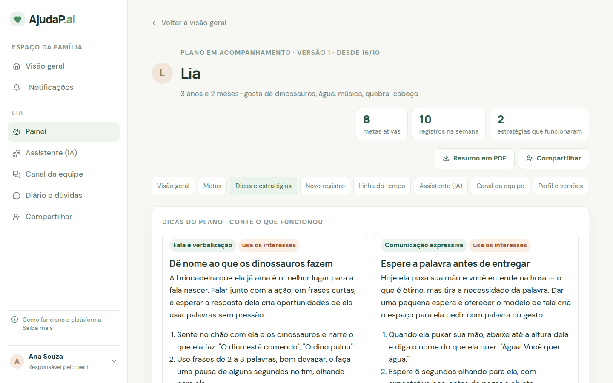

### 5. Registrar o dia a dia

Qualquer pessoa da equipe registra o que observou e marca as áreas relacionadas. Os tipos de registro são:
- conquista;
- atividade;
- comportamento (antes → o que aconteceu → depois);
- observação;
- saúde.

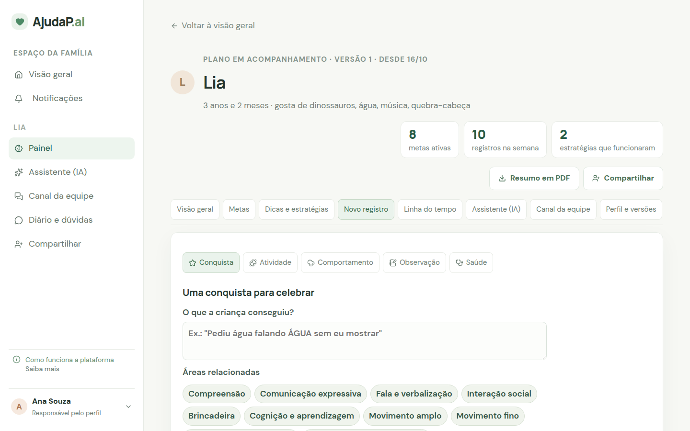

A **linha do tempo** junta tudo o que aconteceu (registros, progresso de metas, estratégias testadas), com filtros e com quem registrou cada item.

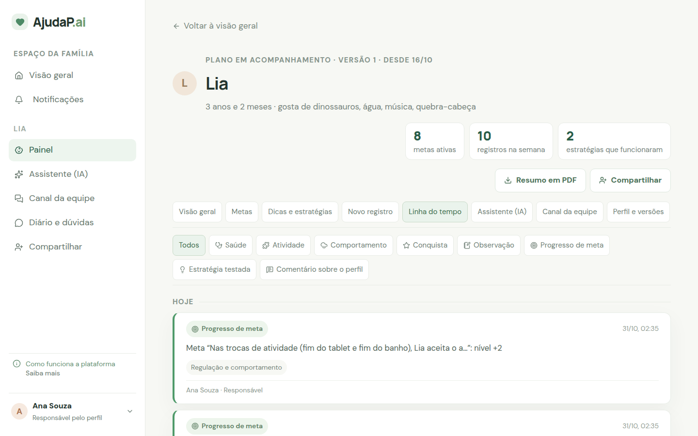

### 6. Tirar dúvidas com o assistente de IA

O assistente conhece o perfil aprovado, as metas, os últimos registros e quais estratégias funcionaram ou não. Pergunte, por exemplo: *"Ela teve outra crise com o tablet, o que eu tento hoje?"*.

As respostas são práticas e personalizadas. Quando o assistente se apoia em materiais oficiais, ele cita a fonte, e quando é o caso, indica procurar um profissional. As conversas ficam salvas.

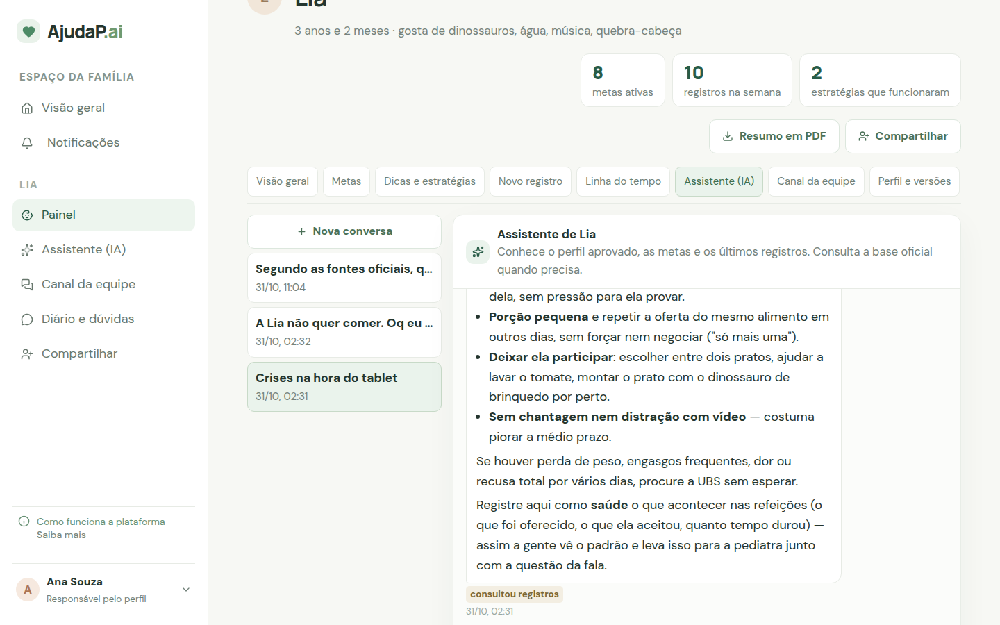

### 7. Trabalhar em equipe

**Compartilhar.** O responsável convida pelo e-mail e escolhe a função da pessoa (professor, médico, terapeuta…). A pessoa cria a conta de acompanhante e aceita o convite. A página explica o que cada papel pode fazer, e o acesso pode ser removido a qualquer momento.

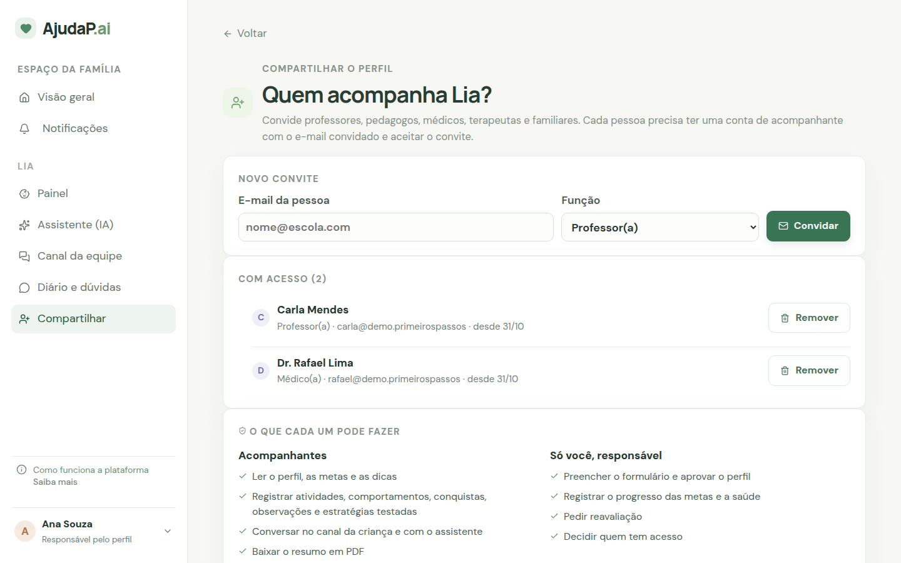

**Canal da equipe.** Cada criança tem um canal de mensagens para a família e quem a acompanha combinarem as coisas, como "vou usar o mesmo aviso aqui na creche".

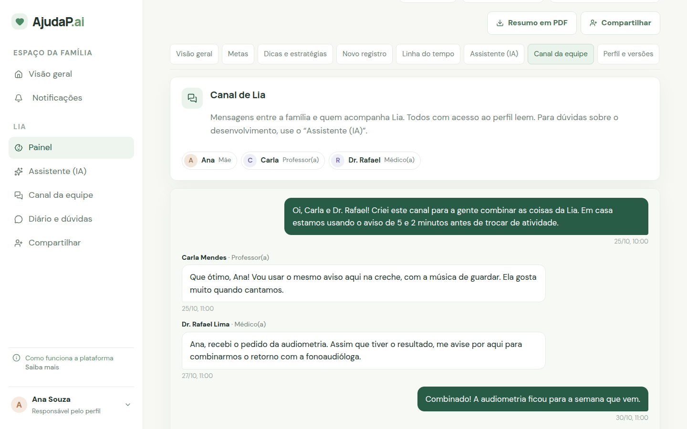

**Notificações.** Quando alguém registra algo ou escreve no canal, os outros recebem um aviso no sino. Também há avisos de perfil aprovado e de convites. Cada notificação leva direto ao lugar certo.

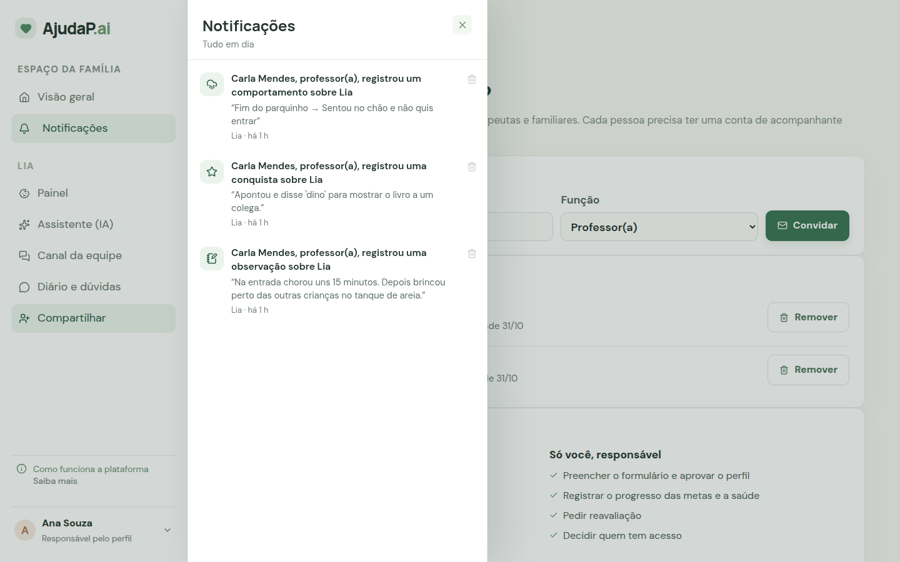

**Visão do acompanhante.** A professora vê só as crianças compartilhadas com ela. Ela lê o perfil e as metas, registra o que observa na escola e usa o canal e o assistente. Ela não altera o perfil, as metas nem quem tem acesso.

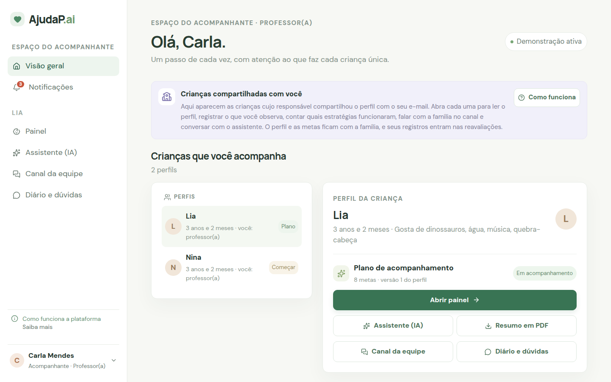

### 8. Reavaliar e ver a evolução

Depois de algumas semanas, o responsável pede uma **reavaliação**. Ele pode fazê-la só com os registros ou atualizando o formulário, que já vem preenchido com as últimas respostas.

O agente recebe:
- o perfil vigente;
- todos os registros (quem fez, função, quando e o quê);
- o progresso das metas;
- as estratégias testadas.

Com isso, ele propõe uma nova versão com o balanço da evolução: cores antes → agora, situação de cada meta e conquistas. A partir da segunda versão aprovada, o painel mostra a evolução entre as versões. Há ainda um **resumo em PDF** para levar à consulta ou à escola.

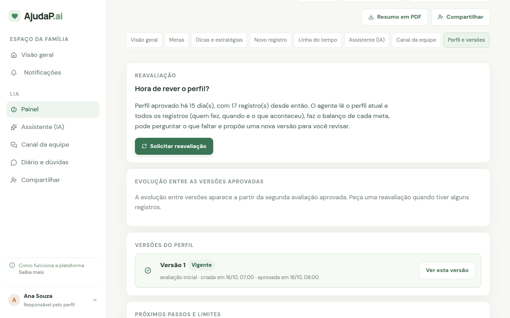

---

## Funcionalidades

| | |
| --- | --- |
| **Contas e papéis** | Login com e-mail e senha; responsável e acompanhante; uma conta pode ter os dois papéis |
| **Formulário** | 14 áreas do desenvolvimento, perguntas por idade, campos abertos, "não sei" ≠ "ainda não" |
| **Agente de perfil** | Proposta com semáforo por área, metas e dicas; consulta a base oficial; faz perguntas extras; ajustes até a aprovação |
| **Painel** | Visão geral, metas com progresso, dicas, registros, linha do tempo, versões do perfil |
| **Assistente (IA)** | Chat que conhece o perfil e os registros e cita fontes; histórico de conversas |
| **Equipe** | Convite por e-mail, canal por criança, notificações, permissões por papel |
| **Reavaliação** | Nova versão com balanço da evolução; comparação entre versões |
| **Resumo em PDF** | Documento para consultas e reuniões escolares |

## Roteiro de demonstração (5 minutos)

1. Na tela inicial, clique em **"Família da Lia (responsável)"**.
2. **Lia (perfil aprovado):** clique em **Abrir painel** e percorra as abas (Visão geral, Metas, Dicas e estratégias, Novo registro, Linha do tempo, **Assistente (IA)**, Canal da equipe, Perfil e versões). No assistente, pergunte *"Ela teve outra crise com o tablet, o que eu tento hoje?"*.
3. **Nina (do zero):**
   - selecione a Nina e clique em **Começar formulário**, depois em **"Preencher com respostas de exemplo"**;
   - clique em **Concluir e gerar mapeamento** e acompanhe o agente ao vivo. Com as respostas de exemplo, ele sempre faz uma pergunta extra;
   - leia a proposta, peça um ajuste (*"Quero focar primeiro no sono"*) e aprove.
4. **Visão da escola:** saia e entre como **"Professora Carla (acompanhante)"**. Registre algo sobre a Lia e veja a notificação chegar para a família.

Cada etapa do agente de perfil leva de 1 a 2 minutos. Uma resposta do assistente leva de 3 a 10 segundos.

**Dados de demonstração** (gerados com `python -m backend.seed` ou pelos botões da tela inicial):
- **Ana**, mãe, responsável.
- **Lia**, com perfil aprovado (relatório real gerado pelo agente) e duas semanas de registros.
- **Nina**, só com o cadastro, para rodar a jornada completa.
- **Prof. Carla**, acompanhante da Lia e da Nina.
- **Dr. Rafael**, pediatra, acompanhante da Lia.

## Cuidados e limites

- O AjudaP.ai **não diagnostica**, não mede idade de desenvolvimento e não substitui pediatra, fonoaudiólogo, terapeuta ou outro profissional. Os textos da IA passam por uma validação automática que barra linguagem diagnóstica.
- As cores do semáforo por idade vêm de **regras em código**, não da IA. A IA escreve o texto, as metas e as dicas.
- É um MVP de hackathon: **use dados fictícios**. Antes de usar com famílias reais, ainda falta:
  - política de retenção e adequação à LGPD;
  - revisão profissional das referências e regras propostas;
  - recuperação de senha.

---

# Parte técnica

## Arquitetura

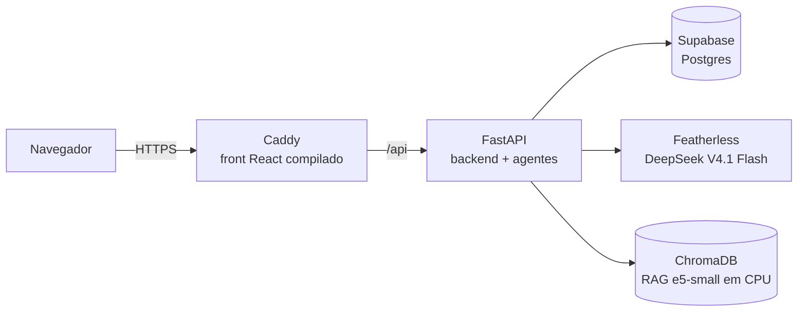

| Camada | Tecnologia |
| --- | --- |
| Frontend | React + Vite (raiz do repositório: `index.html`, `src/App.jsx`, `src/jornada/`), ícones `lucide-react` |
| Backend | FastAPI + Uvicorn (`backend/`), um processo; o agente roda em threads |
| Agentes | Loop agêntico com ferramentas (`src/agente_perfil/`), LLM via API compatível com OpenAI (Featherless, `deepseek-ai/DeepSeek-V4.1-Flash-1017`) |
| RAG | ChromaDB + `intfloat/multilingual-e5-small` (`src/rag/`, base em `chroma_db/`), reranker opcional |
| Banco | Supabase (Postgres) ou SQLite local |
| PDF | ReportLab (`backend/resumo_pdf.py`) |
| Deploy | Docker Compose (Caddy + API) numa EC2, gerenciada por boto3 (`deploy/aws.py`) |

### Estrutura do repositório

```
backend/            API FastAPI: main (formulário), avaliacoes (agente), plataforma, auth, notificacoes, seed, testes
src/App.jsx         app React (telas principais)
src/jornada/        componentes do painel, chat, canal, compartilhar, notificações, cliente da API
src/agente_perfil/  agente de perfil e reavaliação, chat, prompts, ferramentas, repositório (banco)
src/rag/            conversão de PDFs, chunking, indexação e busca
chroma_db/          base vetorial já indexada
data/markdown_docs/ documentos convertidos para Markdown (insumo da indexação)
pdfs/               documentos originais da base de conhecimento
prompts/            prompts e respostas usados no desenvolvimento; 07/ouput.json é a fonte das perguntas
supabase/schema.sql esquema do Postgres
deploy/             script boto3, Caddyfile e dependências do deploy
frontend/           primeiro protótipo do formulário (não faz parte do app integrado)
```

Mais detalhes: agente e chat em [src/agente_perfil/README.md](src/agente_perfil/README.md); RAG em [src/rag/README.md](src/rag/README.md).

### Login e papéis

- Contas com e-mail e senha (hash PBKDF2) e sessão por token (`Authorization: Bearer`).
- O backend descobre pelo token quem age e o papel dele em cada criança. O corpo da requisição não decide isso.
- O acompanhante só acessa as crianças compartilhadas com ele. Se tentar mexer no perfil, nas metas ou em quem tem acesso, o backend responde 403.
- Internamente, o papel de acompanhante se chama `professor`, nome herdado do modelo original.
- Contas criadas antes do login (sem senha) são recuperadas criando a conta com o mesmo e-mail.

### Banco de dados

Toda a leitura e escrita passa por [src/agente_perfil/repositorio.py](src/agente_perfil/repositorio.py), que funciona com dois bancos:
- **Supabase (Postgres):** é o padrão quando a `DATABASE_URL` está no `.env`. O esquema fica em [supabase/schema.sql](supabase/schema.sql): 17 tabelas, com RLS ligado e sem políticas. Ou seja, a API pública do Supabase não acessa nada, e só o backend lê e escreve.
- **SQLite local:** sem `DATABASE_URL`, usa `backend/data/plataforma.sqlite3`, criado sozinho a partir de [src/agente_perfil/schema_local.sql](src/agente_perfil/schema_local.sql).

Configurar o Supabase:
1. *SQL Editor* → cole e rode `supabase/schema.sql` (pode rodar de novo sem erro).
2. *Connect* → *Session pooler* → copie a URI para o `.env`: `DATABASE_URL=postgresql://postgres.<ref>:<senha>@aws-0-<região>.pooler.supabase.com:5432/postgres`.
3. Para trazer os dados do SQLite: `.venv/bin/python -m backend.migrar_para_supabase`. O script é idempotente e confere as contagens no fim.

Limite de conexões: o Session pooler gratuito aceita 15 conexões no total, somando todos os processos. Cada processo do backend usa de 2 a 5 (`PG_POOL_MIN` / `PG_POOL_MAX`). Com vários processos, use o *Transaction pooler* (porta 6543), que já é compatível.

### Formulário: contrato

- **Perfil:** apelido, idade em meses, ano escolar, vínculo do informante, idiomas, interesses, prioridade familiar, prematuridade e perda de habilidades relatada.
- **14 áreas:** perguntas do JSON, referência visível, resposta, exemplos e contexto. "Não sei" e "não se aplica" são opções distintas de "ainda não".
- **Seleção das perguntas:** usa a última faixa disponível de cada domínio até a idade informada. Para COG, COM_R e COM_E, a partir de 6 anos, usa o final do ano escolar anterior. O frontend (`src/questionnaire.js`) e o backend (`backend/main.py`) aplicam a mesma regra.
- **Sem escore:** o formulário não calcula escore nem diagnóstico. O semáforo é calculado depois, com regras em código (`src/agente_perfil/dossie.py`). SAU e CTX permanecem contextuais. A idade corrigida não é calculada.

### Endpoints principais

- **Formulário:** `GET /api/questionario`, `POST /api/formularios`.
- **Agente de perfil:** `/api/avaliacoes/*`, em [backend/avaliacoes.py](backend/avaliacoes.py). As execuções são assíncronas (202 + consulta da sessão).
- **Plataforma:** pessoas, crianças, painel, registros, chat e demo, em [backend/plataforma.py](backend/plataforma.py).
- **Login:** `/api/auth/*`, em [backend/auth.py](backend/auth.py). **Notificações:** `/api/notificacoes*`, em [backend/notificacoes.py](backend/notificacoes.py).
- **Documentação interativa:** http://localhost:8000/docs.

## Rodar localmente

### Opção A: clonar e rodar na sua máquina

Requisitos: Python 3.10+, **Node.js 20+** e cerca de 1 GB livre para o modelo de embedding (`intfloat/multilingual-e5-small`, baixado na primeira busca). GPU não é obrigatória. Para pular o RAG, defina `RAG_DESATIVADO=1`.

**Linux / macOS:**

```bash
git clone https://github.com/MatCarvalho21/HackathonLEPV.git
cd HackathonLEPV
cp .env.example .env                               # preencha API_KEY (e DATABASE_URL, se usar Supabase)

python3 -m venv .venv
.venv/bin/pip install -r backend/requirements.txt
.venv/bin/pip install torch --index-url https://download.pytorch.org/whl/cpu   # RAG em CPU (opcional)
.venv/bin/pip install -r src/rag/requirements.txt                               # RAG (opcional)
npm install                                        # frontend (na raiz)
.venv/bin/python -m backend.seed                   # dados de demonstração

# dois terminais, a partir da raiz
RAG_DEVICE=cpu .venv/bin/python -m uvicorn backend.main:app --host 127.0.0.1 --port 8000
npx vite --host 127.0.0.1 --port 5173
```

**Windows (PowerShell):**

```powershell
git clone https://github.com/MatCarvalho21/HackathonLEPV.git
cd HackathonLEPV
Copy-Item .env.example .env        # preencha API_KEY
python -m venv .venv
.venv\Scripts\python -m pip install -r backend/requirements.txt
.venv\Scripts\python -m pip install torch --index-url https://download.pytorch.org/whl/cpu   # opcional (RAG)
.venv\Scripts\python -m pip install -r src/rag/requirements.txt                             # opcional (RAG)
npm install
.venv\Scripts\python -m backend.seed

# Terminal 1
$env:RAG_DEVICE="cpu"          # ou: $env:RAG_DESATIVADO="1"
.venv\Scripts\python -m uvicorn backend.main:app --host 127.0.0.1 --port 8000
# Terminal 2
npx vite --host 127.0.0.1 --port 5173
```

Verificação rápida: `curl http://127.0.0.1:5173/api/health` deve responder `{"status":"ok"}`.

### Opção B: Docker (igual à produção)

```bash
docker compose up --build      # abre em http://localhost
```

Lê o `.env` da raiz. Use o formato `CHAVE=valor`, sem espaços em volta do `=`.

## Variáveis de ambiente

Modelo completo em [.env.example](.env.example).

| Variável | Padrão | Uso |
| --- | --- | --- |
| `API_KEY` | — | Chave do Featherless (LLM) |
| `DATABASE_URL` | — | Supabase (Session pooler). Sem ela, usa SQLite local |
| `PG_POOL_MIN` / `PG_POOL_MAX` | `2` / `5` | Conexões do pool por processo |
| `FORM_DB` | `backend/data/plataforma.sqlite3` | Caminho do banco local |
| `RAG_DEVICE` | GPU com mais memória livre, ou CPU | `cuda:0`, `cuda:1` ou `cpu` |
| `RAG_DESATIVADO` | `0` | `1` sobe sem a base vetorial |
| `RAG_RERANKER` | `0` | `1` liga o reranker (pesado, ~2,2 GB) |
| `LLM_MODELO` | `deepseek-ai/DeepSeek-V4.1-Flash-1017` | Modelo dos agentes |
| `AWS_ACCESS_KEY_ID` / `AWS_SECRET_ACCESS_KEY` / `AWS_REGION` | — / — / `us-east-1` | Só para o `deploy/aws.py`; não vão para o servidor |
| `EC2_TIPO` | `t3.small` | Tipo da máquina do deploy |

## Testes

```bash
.venv/bin/python -m unittest backend.test_main backend.test_agente -v   # Windows: .venv\Scripts\python ...
npm run build
```

Os testes usam um LLM falso e um SQLite temporário. Com `TESTE_PG=1`, os mesmos testes rodam no Supabase, num schema temporário apagado no fim, sem tocar nos dados reais. A cobertura inclui:
- regras do semáforo e validação (linguagem diagnóstica, metas);
- pausa e retomada com perguntas;
- ajuste e aprovação;
- jornada da plataforma (conta → criança → formulário → proposta → vigente);
- registros, painel e turma do professor;
- contexto e ferramentas do chat;
- seed de demonstração.

## Problemas comuns

- **A página abre, mas as ações falham:** o backend não está rodando na porta 8000 da mesma máquina do Vite.
- **`Address already in use`:** já existe um processo na porta. Veja com `ss -ltnp | grep -E '8000|5173'`.
- **Vite falha com erro de sintaxe ou `Cannot find module`:** use Node 20+ e rode `npm install` na raiz.
- **Agente com erro `RuntimeError: Defina API_KEY`:** falta o `.env` na raiz.
- **"Coleção ... e5small não existe" no log:** a base leve ainda não foi indexada, e o sistema usa a coleção antiga (bge-m3) enquanto isso. Ver [src/rag/README.md](src/rag/README.md).

## Deploy na AWS

Tudo roda numa EC2 `t3.small` (2 vCPU, 2 GB de RAM + 2 GB de swap, Ubuntu 24.04) com dois containers ([docker-compose.yml](docker-compose.yml), [Dockerfile](Dockerfile)):
- **web:** Caddy servindo o front compilado, com **HTTPS automático** (Let's Encrypt) em `https://<ip-com-traços>.sslip.io`, sem precisar de domínio;
- **api:** FastAPI, agente e RAG em CPU. O modelo de embedding já vem dentro da imagem, e o processo usa ~1 GB de RAM.

O banco continua no Supabase. A máquina fica em `us-east-2`, porque a conta da organização só libera essa região, a ~12 ms do Supabase (`us-east-1`).

### Preparação na AWS (uma vez)

1. **Créditos:** em *Billing and Cost Management → Credits*, resgate o cupom.
2. **Alerta de gasto:** em *Billing → Budgets*, crie um orçamento mensal com alerta por e-mail.
3. **Usuário de deploy:** em *IAM → Users → Create user*, crie `deploy-hackathon`, sem acesso ao console.
   - Em *Attach policies directly*, marque `AmazonEC2FullAccess` e `AmazonSSMReadOnlyAccess`.
   - Depois, em *Security credentials → Create access key → CLI*, gere a chave.
4. **Chaves no `.env`:** coloque no `.env` da raiz `AWS_ACCESS_KEY_ID`, `AWS_SECRET_ACCESS_KEY` e `AWS_REGION`.

### Comandos

O script [deploy/aws.py](deploy/aws.py) usa boto3 e cria tudo sozinho: chave SSH, firewall, máquina, IP fixo e Docker.

```bash
.venv/bin/pip install -r deploy/requirements.txt

.venv/bin/python deploy/aws.py subir              # cria tudo e põe no ar (1ª vez ~10 min). Rode de novo a cada mudança
.venv/bin/python deploy/aws.py soft-kill          # desliga: para a cobrança por hora, mantém disco/imagens/IP (~US$ 0,20/dia)
.venv/bin/python deploy/aws.py subir --so-ligar   # volta do soft kill em ~1 min, mesmo endereço
.venv/bin/python deploy/aws.py hard-kill          # apaga tudo: cobrança zero (o próximo `subir` recria do zero, com outro IP)
.venv/bin/python deploy/aws.py status             # estado da máquina, URL e saúde da API
.venv/bin/python deploy/aws.py logs [api|web]     # logs dos containers
.venv/bin/python deploy/aws.py ssh                # terminal na máquina
```

Detalhes:
- **O que vai para o servidor:** o `subir` envia os arquivos do diretório de trabalho, não só o último commit. Ficam de fora o `.env`, os venvs, `pdfs/` e `frontend/`. O `.env` do servidor é gerado só com as variáveis da aplicação; as chaves da AWS nunca saem da sua máquina.
- **Segurança:** a porta 22 (SSH) fica aberta só para o seu IP atual, e a regra é atualizada a cada comando. As portas 80 e 443 ficam públicas.
- **Se o HTTPS falhar:** `subir --sem-https` serve em `http://IP`.
- **Bloqueio da organização:** se aparecer *explicit deny in a service control policy*, a organização dona da conta bloqueia aquela região. Mude `AWS_REGION`.

Custo: com a máquina ligada, ~US$ 0,03/h (~US$ 0,70/dia). Desligada (soft kill), ~US$ 0,20/dia. Depois do hackathon, rode `hard-kill`.
