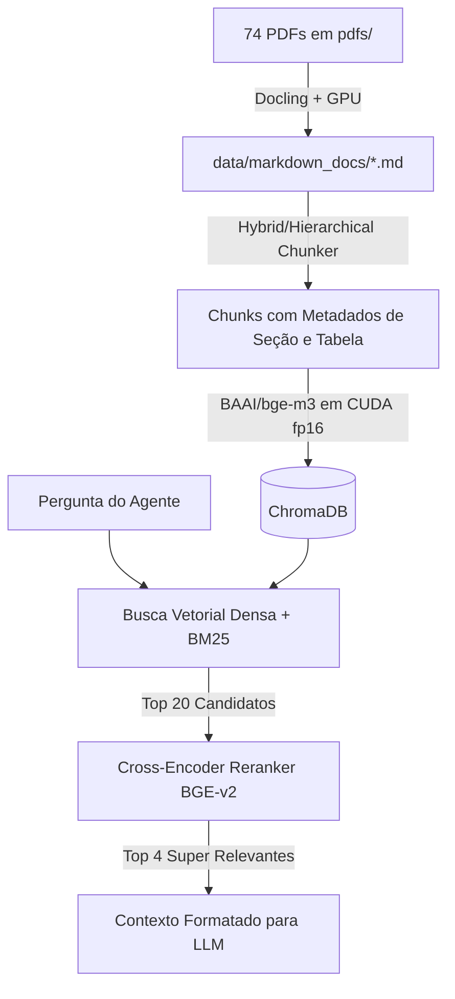

# Novo Pipeline de RAG com GPU: Parsing Estruturado (Docling), Semantic Chunking e Reranking

## 1. Monitoramento do Hackathon Registrado
A sua mensagem foi registrada em [`prompts/matheus/17/pergunta.md`](file:///home/matheus/matheus/HackathonLEPV/prompts/matheus/17/pergunta.md) e esta resposta está salva em [`prompts/matheus/17/resposta.md`](file:///home/matheus/matheus/HackathonLEPV/prompts/matheus/17/resposta.md). Todas as próximas mensagens continuarão sendo salvas sequencialmente (`18`, `19`, ...).

---

## 2. Diagnóstico da Nova Máquina (Hardware Detectado)
Analisamos a máquina atual e o setup é excelente para RAG de alta fidelidade:
* **GPU**: **2x NVIDIA Quadro RTX 6000 (24 GB de VRAM cada = 48 GB total)**!
  * GPU 1 está com 100% da VRAM livre (0% de uso);
  * GPU 0 possui ~20 GB livres.
* **Driver NVIDIA**: 575.57.08 (CUDA 12.9).
* **Armazenamento**: >840 GB livres em disco SSD (`/mnt/diskSSD2TB`).

Com 24 GB a 48 GB de VRAM, saímos do gargalo de CPU lenta e podemos rodar:
1. Modelos visuais e de layout para extração de PDFs (**Docling** com aceleração PyTorch/CUDA);
2. Embeddings densos multilíngues em lote de alta velocidade (**BAAI/bge-m3** na GPU);
3. **Cross-Encoder Reranker** (`bge-reranker-v2-m3`), que é o maior salto de precisão para qualquer RAG;
4. Se desejado, até mesmo um **LLM local e gratuito** (como `Qwen2.5-14B-Instruct` ou `Llama-3.1-8B-Instruct`) rodando localmente sem depender de cotas ou limites de APIs externas.

---

## 3. O Problema da Abordagem Anterior vs. O Novo Pipeline

### Como estava antes:
* `pypdf` extrai texto cru página por página;
* Perde hierarquia (`# Título`, `## Subtítulo`), funde colunas de relatórios/cadernetas e quebra tabelas e questionários (como SWYC e Caderneta da Criança);
* O chunker apenas cortava arbitrariamente a cada 800 caracteres com sobreposição de 150 caracteres, podendo fatiar frases e tabelas no meio.

### Nova Arquitetura Proposta (100% Free / Open-Source):

### Detalhes das Camadas:

1. **Camada 1: Parsing para Markdown Estruturado (Docling)**
   * **IBM Docling** (open-source, licença MIT):
     * Lê PDFs preservando títulos, subtítulos, listas e tabelas completas em sintaxe Markdown (`| Coluna 1 | Coluna 2 |`);
     * Utiliza redes neurais aceleradas por GPU para detecção de layout (DocLayNet e TableFormer);
     * Gera arquivos intermediários em `data/markdown_docs/` para você inspecionar e não precisar reprocessar os PDFs toda vez.

2. **Camada 2: Chunking Estruturado e Hierárquico**
   * Respeita fronteiras de cabeçalhos (`#`, `##`, `###`);
   * Preserva tabelas inteiras dentro do mesmo bloco (essencial para marcos de desenvolvimento etários);
   * Adiciona metadados ricos por chunk: `{ "source": "caderneta.pdf", "section": "Marcos Motores > 18 meses", "page": 12, "is_table": true }`.

3. **Camada 3: Embeddings Multilíngues em GPU (`BAAI/bge-m3`)**
   * O `bge-m3` já estava configurado no projeto e é a escolha ideal (1024 dimensões, contexto de até 8192 tokens);
   * Com PyTorch em CUDA (fp16), o lote pode subir para 128 chunks simultâneos, reduzindo o tempo de indexação dos 74 PDFs para segundos.

4. **Camada 4: Reranking com Cross-Encoder (`bge-reranker-v2-m3`)**
   * Na busca, o ChromaDB recupera os **Top 20** candidatos mais próximos;
   * O Cross-Encoder reanalisa a pergunta junto com cada candidato e atribui uma nota de relevância real;
   * Retorna apenas os **Top 4** trechos mais certeiros, eliminando falsos positivos.

---

## 4. Plano de Ação para Implementar

1. **Configurar o Ambiente Virtual (.venv) com suporte a GPU**:
   * Instalar `torch` com CUDA 12.x;
   * Instalar `docling`, `sentence-transformers`, `chromadb`, `accelerate`.
2. **Criar o Conversor `src/rag/convert_to_markdown.py`**:
   * Processar os PDFs para Markdown estruturado com barra de progresso e GPU.
3. **Atualizar `src/rag/chunker.py` e `src/rag/indexer.py`**:
   * Implementar chunking ciente de Markdown/seções e reindexar a base.
4. **Adicionar o Reranker em `src/rag/retriever.py`**:
   * Disponibilizar busca refinada para o backend e agentes.

Podemos iniciar a configuração do ambiente `.venv` com CUDA e a instalação das bibliotecas?
