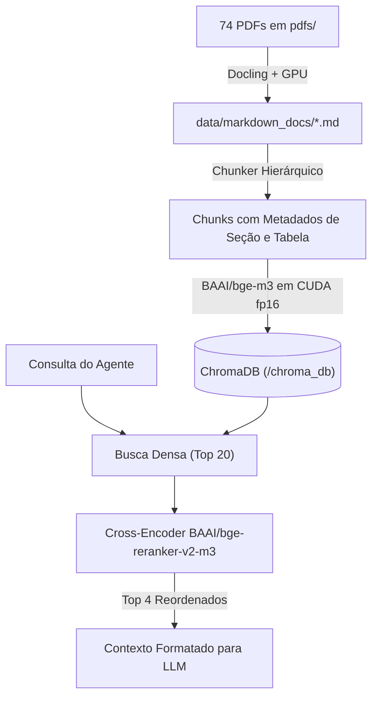

# Pipeline RAG de Alta Fidelidade (Docling + GPU + Reranker)

Esta pipeline converte os 74 PDFs de referência em `/pdfs` (Caderneta da Criança, Guias da OMS, Relatórios EEF, Portarias do MEC, Pyramid Model e SWYC) em **Markdowns estruturados com preservação de layout e tabelas**, fatiando-os em **chunks hierárquicos** com embeddings multilíngues (`BAAI/bge-m3`) e **re-ranqueamento com Cross-Encoder** (`BAAI/bge-reranker-v2-m3`) acelerado por GPU CUDA.

---

## 🏗️ Arquitetura do Pipeline



### Principais Vantagens em Relação ao Pipeline Simples:
1. **Preservação de Tabelas e Questionários**: O `docling` converte tabelas para Markdown nativo (`| col | col |`), e o `chunker.py` nunca as corta no meio de uma linha.
2. **Metadados Hierárquicos**: Cada chunk sabe a qual cabeçalho/seção pertence (ex: `Marcos Motores > 18 a 24 meses`).
3. **Reranker de Duas Etapas (Two-Stage Retrieval)**: Elimina falsos positivos ao reanalisar os 20 melhores trechos com atenção cruzada antes de entregar ao LLM.
4. **Aceleração por GPU (CUDA)**: Utiliza as GPUs Quadro RTX 6000 para vetorização e reranking ultra-rápidos.

---

## 🚀 Guia Passo a Passo de Execução

### Passo 1: Entrar na pasta do projeto e criar o ambiente virtual

```bash
cd /home/matheus/matheus/HackathonLEPV

# Cria o ambiente virtual dedicado
python3 -m venv .venv

# Ativa o ambiente virtual
source .venv/bin/activate
```

---

### Passo 2: Instalar o PyTorch com suporte a CUDA 12

Como a máquina possui GPUs NVIDIA e CUDA 12.9, instale o PyTorch compilado com CUDA:

```bash
pip install --upgrade pip

# Instala PyTorch com CUDA 12.4 / 12.x
pip install torch torchvision --index-url https://download.pytorch.org/whl/cu124
```

Para validar se o PyTorch reconheceu a GPU:
```bash
python3 -c "import torch; print('CUDA disponível:', torch.cuda.is_available(), '| Dispositivos:', torch.cuda.device_count(), '| Modelo:', torch.cuda.get_device_name(0))"
```

---

### Passo 3: Instalar as demais dependências do RAG

```bash
pip install -r src/rag/requirements.txt
```

---

### Passo 4: Converter os PDFs para Markdown Estruturado (Docling)

Executa a leitura dos PDFs na pasta `pdfs/` e salva os `.md` em `data/markdown_docs/`:

```bash
# Converte todos os PDFs com detecção de layout e tabelas via GPU:
python3 -m src.rag.convert_to_markdown

# (Opcional) Para testar a conversão em apenas 3 PDFs primeiro:
python3 -m src.rag.convert_to_markdown --limit 3

# (Opcional) Para filtrar apenas um PDF específico (ex: caderneta):
python3 -m src.rag.convert_to_markdown --filter caderneta
```

---

### Passo 5: Indexar no ChromaDB com Embeddings em GPU

Lê os Markdowns estruturados, aplica o chunking hierárquico e gera os vetores densos:

```bash
# Indexação com recriação completa da coleção:
python3 -m src.rag.indexer --reindex

# Ou indexação rápida de um arquivo específico:
python3 -m src.rag.indexer --filter caderneta
```

---

### Passo 6: Testar as Consultas e o Reranker

Você pode testar diretamente com uma pergunta:

```bash
python3 -m src.rag.test_query "Quais os marcos motores esperados para uma criança de 2 a 3 anos?"
```

Ou abrir o **Modo Interativo contínuo**:
```bash
python3 -m src.rag.test_query
```
*(Digite sua pergunta e veja os trechos recuperados, a pontuação do Cross-Encoder e a tabela/seção correspondente).*

---

## �� Uso no Backend e nos Agentes de IA

No código do seu agente ou endpoints FastAPI:

```python
from src.rag.retriever import consultar_base_conhecimento, AGENT_TOOL_SCHEMA

# Chamada direta:
contexto = consultar_base_conhecimento("Estratégias de intervenção para comportamentos de bater e morder", top_k=4)

# Schema de Tool (Function Calling para Gemini/OpenAI/Claude):
# Basta incluir AGENT_TOOL_SCHEMA na lista de tools do LLM.
```
